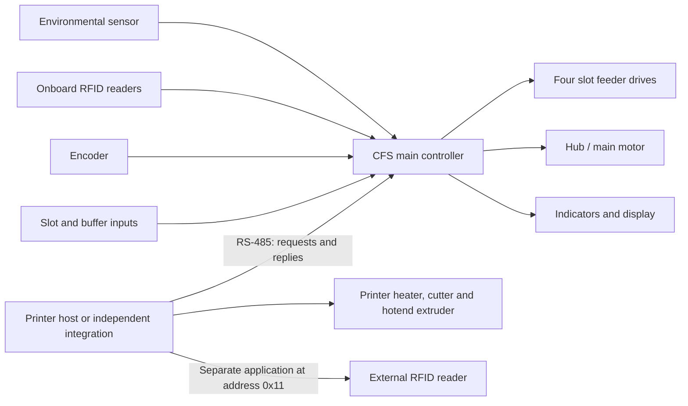

# How the CFS fits together

The Creality Color Filament System is an active filament-handling controller, not a passive spool reader. A printer host sends commands over a shared half-duplex serial bus. The CFS firmware owns its feeder drives, hub/main motor, input scanning, RFID acquisition, encoder accounting and front-panel indications.

This reference describes the recovered communication interfaces. An independent integration does not need Creality's Python extensions or a reconstruction of a security chip's internal firmware.

## Components and responsibilities

The external RFID reader is a different device from the readers inside a CFS. Its address, commands, cache behavior and tag-format overrides are documented in [External reader](external-reader.md).

| Component | Responsibility | What an integration must not assume |
|---|---|---|
| Printer host | Address management, command scheduling, reply/event handling, material profiles and coordination with printer motion | The CFS will coordinate a third-party printer's heater, cutter or hotend extruder |
| CFS main controller | Four-slot filament transport, common hub drive, autonomous insertion/RFID logic and cached status | A command acknowledgement proves filament reached the hotend |
| Buffer endpoints | Two physical input signals used by buffer control | A second digital controller or an additional addressed hub device is required for these signals |
| Onboard RFID path | Tag detection, authentication, decoding and usage estimation | Every returned cache is a new scan, or every hardware revision uses the same tag path |
| Printer material database | Material identity, temperature limits and printing parameters | The forty-byte tag record contains nozzle temperatures or a complete slicer profile |

The inspected main firmware exposes two four-bit input banks and two buffer bits. Terms such as “gate,” “post-gear” and “hub sensor” are not interchangeable names for extra protocol fields. Use the exact mappings in [Sensors](sensors.md), rather than inventing an additional shared switch.

## Host-facing layers

1. **Electrical link.** Power, transceiver behavior, direction control and connector revision must match the actual hardware. UART framing alone does not establish electrical compatibility.
2. **Framing.** Decode the binary packet stream, check CRC and preserve complete packets across arbitrary read boundaries.
3. **Address management.** Establish which UUID owns each logical address and distinguish application identity from loader identity.
4. **Application operations.** Send commands with the correct slot encoding, payload width and firmware profile.
5. **Workflow coordination.** Handle intermediate messages, slot events, delayed completion and host-side printer actions.
6. **Material interpretation.** Decode returned tag data and join its material ID to a database or a caller-managed profile.

See [Transport](transport.md), [Addressing](addressing.md), [Command reference](commands.md) and [Integration guide](integration.md) in that order.

## Firmware families and identities

The supplied system contains main application versions **1.1.3** and **1.5.2**. Their wire formats are related but not identical. In particular, a normal status response has four data bytes on 1.1.3 and six on 1.5.2. A slot-event response has four data bytes on both. Do not infer a profile from length without first considering the reply status.

The G30 and G32 application files are byte-identical within each of these supported versions. This does not prove that their bootloaders, boards or wiring are identical. The separate external-reader application and known G32 bootloader require their own endpoint profiles.

Use [Compatibility](compatibility.md) to select a profile. The presence of both printer filesystem slots does not establish which slot a physical printer currently boots.

## State belongs to several different layers

An implementation must keep these separate:

- **Addressing identity mode:** application or loader.
- **Request mode/status byte:** a byte inside the CRC-covered packet, used differently by the application and maintenance paths.
- **Current application operation state:** idle, preloading, printing and other runtime states reported by status queries.
- **Command action:** for example, the enable/disable action inside a buffer-control payload.
- **Persistent factory operating mode:** a flash parameter read at startup; changing it can reset the MCU and cause automatic fixture motion.
- **Host printer state:** printing, paused, cancelled, heater readiness and cutter state belong to the surrounding integration.

These fields are not alternative encodings of one enumeration. [Modes and workflows](modes-and-workflows.md) defines them and their transitions.

## Cached data versus actions

Read requests are not all acquisition requests. RFID and environment queries primarily return firmware-maintained caches. Encoder reads return a sampled, scaled position. A command that starts RFID acquisition can also move filament; it is not a substitute for a passive cache read.

Likewise, a previously successful tag cache can outlive a card's presence on the separate external reader. Temperature and humidity can remain stale after an acquisition failure or while the firmware is in a test path. The command reference and sensor chapters describe each query's freshness limits.

A host must not treat a successful binary reply as proof of mechanical success. Some feed stages acknowledge before their actual work finishes; some commands have later progress or result messages. There is no general packet sequence number to make blind retries safe.

## Safety and scope

- Use one bus master. Do not add an independent transmitter beside the printer's active master.
- The CFS can react autonomously to inserted filament. “The host sent only reads” does not disable that firmware behavior.
- Neither heartbeat loss nor every nominal stop command is an unconditional emergency stop. A busy guard can reject a stop, and clearing a workflow flag need not cancel work already underway.
- Isolate reset, update, fixture and credential operations from normal integration APIs. See [Maintenance](maintenance.md).
- No electrical, motion, RFID-write or flash operation was run on a device during this documentation work. Static recovery and offline checks are not physical interoperability tests.

